<p align="center"></p>

# VerifAI — Shadow AI Governance (Toronto Tech Summit 2026, Track B)

Cross-platform browser extension (Chrome, Edge, Brave, Firefox) that blocks unapproved AI sites,
redacts PII just-in-time before it reaches approved assistants, and feeds a local SOC dashboard with
AI-activity and redaction events — no prompt text ever leaves the browser.

**Submission:** [VerifAI TTS 2026 – AbcdML Document (PDF)](docs/VerifAI%20TTS%202026%20-%20AbcdML%20Document.pdf) ·
**Demo videos:** [Release v0.5.5](https://github.com/snailmailer/VerifAI_TTS_2026/releases/tag/v0.5.5)
(`VerifAI Actual App Testing.mp4`, full live test) · [`VerifAI Recorded MVP Demo.mp4`](VerifAI%20Recorded%20MVP%20Demo.mp4) (captioned installer + dashboard, in repo)

Submitted by Abcd Macabuhay-Ladra and Gayathri Rajamohan — 26 October 2026.

---

# VerifAI Approval Gate — Standalone Windows installation

This repository contains the browser extension, local collector, SOC dashboard and the **standalone Windows installer** (USB / per-user, no admin, no internet). Step-by-step install, verification, repair and uninstall instructions are in [docs/INSTALLATION-GUIDE.md](docs/INSTALLATION-GUIDE.md).

## Quick start

```
npm install          # dev dependencies (typescript, swc) for build:ui / typecheck / test
npm run build:ui     # compile src/*.ts dashboard modules
npm run build:policy # regenerate manifest.json / ai-block-rules.json from ai-policy.js
npm run build:mvp    # build MVP\VerifAI-MVP-USB  (Install-VerifAI.cmd, bundled node.exe)
npm test             # node --test
```

Copy `MVP\VerifAI-MVP-USB` to a USB drive and double-click `Install-VerifAI.cmd` on the target Windows PC.

## MVP USB installer (Windows, zero prerequisites)

`npm run build:mvp` builds `MVP\VerifAI-MVP-USB\` — a self-contained Windows
package for a USB stick. It bundles a portable Node.js runtime (`runtime\node.exe`,
MIT notice included), the collector, the extension for Chromium and Firefox, and
`Install-VerifAI.cmd`. Nothing is downloaded. The installer verifies every file
against `SHA256.json` before running, copies the runtime to
`%LOCALAPPDATA%\VerifAI\Runtime` (so the stick can be removed), stages the
extension in the stable auto-update folders, opens each detected browser's
extensions page with the folder path on the clipboard, detects the IDs the
browsers assign, installs the collector/native bridge/startup entry with daily
JSON/PDF logs, and health-checks. Re-running from a newer stick upgrades in place
and keeps records. `Uninstall-VerifAI.cmd` removes startup/bridge registration.

`install-windows.ps1` now accepts `-NodePath` and recognises a collector started
by a different Node binary (identity = `node.exe` image + exact installed script
path), recording the runtime used in `App\runtime.json`.

Verified on this workstation: a non-interactive run completed in 3 s, switched
the live collector to the bundled runtime, preserved all 62 records, passed the
native-bridge protocol on the bundled runtime, and refreshed the daily logs.
Limits: Windows only; the browser still asks the user to enable the extension;
Firefox temporary add-ons disappear on restart until a signed release exists.

## Automatic browser-extension installation (visible, cancellable)

`deployment/auto-install-extension.ps1` installs VerifAI into Chrome, Edge and Brave **without "Load
unpacked"** by writing the per-user `ExtensionInstallForcelist` policy (HKCU, no admin) that points at the
signed VerifAI CRX, then watching each browser install it in a progress window with **Cancel and undo**.
The Standalone `Setup.cmd` tries it first and falls back to the guided steps per browser;
`Auto-Install-Extension.cmd` / `Undo-Auto-Install.cmd` run it alone.

What the browsers themselves allow (verified against the Chromium policy template and Microsoft's
Edge policy docs, and confirmed live on this unmanaged PC where Chrome silently ignored the policy):

| Package source | Unmanaged PC | Domain / Entra / Chrome-Enterprise-Core enrolled PC |
|---|---|---|
| Store-published (store IDs in `distribution.config.json`) | **auto-installs** | auto-installs |
| Self-hosted signed CRX (current mode) | refused by the browser | **auto-installs** |

The script detects enrollment, picks the route that will actually work, says so in the window, and
changes nothing when neither applies (then the guided Load-unpacked steps are used). `--load-extension`
is not used: Chrome 137+ branded builds ignore it and it needs a fresh browser process. Publishing to the
Chrome Web Store / Edge Add-ons is therefore the one step that makes installation automatic on *every*
machine; see `PUBLISH-CHECKLIST.md`.


## Live-editor redaction and daily event logs (0.5.4)

The redaction layer was reworked after testing against the real Gemini (Quill)
and Perplexity (Lexical) composers in Chrome, Edge, Brave and Firefox engines:

- Typed text is checked when the user submits (Enter, Send/Submit button, form
  submit), never mid-word while typing, so partially typed values are not
  replaced and no fragments leak after a placeholder. Pastes and drops are
  checked immediately, including editors that handle paste themselves.
- Rich editors are edited one matched range at a time through native input
  transactions, with a settle tick so editor frameworks follow their own
  selection model; paragraph structure is preserved and the result is verified
  only after the editor has reconciled. If an editor rejects the edit, the
  submission stays cancelled and the event is reported as not verified.
- The notice no longer uses `innerHTML` (Trusted Types sites blocked it) and a
  notice failure can no longer suppress the metadata event.
- `m365.cloud.microsoft` (Microsoft 365 Copilot) is approved alongside the other
  Copilot hosts; browsers prompt once for the new site permission on reload.

Verified live with synthetic data: Gemini and Perplexity, signed out, for
Enter, Send-button and clipboard-paste paths. Copilot could not be tested live
without signing in; its hosts are covered by the textarea/rich-editor fixture
only. The content script does not depend on sign-in state. Browser-engine
fixture tests run in `tests/redaction-engines.test.js` against every installed
engine; an engine that cannot start headless is reported as skipped, not passed.

Daily logs: after every persisted event the collector rewrites that day's
`AI_Activity_Logs_<dd_Mon_yyyy>.json/.pdf` and
`Redacted_PII_Logs_<dd_Mon_yyyy>.json/.pdf` inside a `<Mon_yyyy>` folder under
the configured event-log directory (this workstation:
`D:\VerifAI TTS 2026\EVENT LOGS`). One file per type per day is kept current;
a new month folder appears automatically with the first event of that month.
Logs contain the same metadata as the dashboard, never prompt text or identifier
values. Configure with `install-windows.ps1 -UpgradeInstalledCollector
-EventLogsDirectory '<absolute path>'`; the directory is restricted to the
current account and SYSTEM. The PDF is generated without third-party
dependencies (Helvetica, Latin-1; other characters appear as `?`).

## Canadian resident records (0.5.3)

Added labeled Resident names (including accented/hyphenated names), Canadian
SINs, Ontario-format OHIP cards and driver's licences, and labeled one-line
addresses including city, province and postal code. These are privacy-oriented
format matches, not checks that an identifier was officially issued or passes a
checksum; invalid-looking but potentially sensitive values are still redacted.
Unlabeled names, arbitrary provincial/international card formats and multiline
address continuations are not guaranteed. The collector and browser metadata
validator accept the new categories; raw resident records are never logged.
Upgrade the collector as well as reloading the extension in every browser, then
refresh existing AI tabs. Previously sent chat messages are not retroactively
removed from provider storage.

## PII editor repair (0.5.2)

Reload the extension and refresh open Copilot, Gemini and Perplexity tabs in
each browser. This release supports additional explicitly labeled name,
compact/spaced SSN and birthday formats, uses editor input transactions for
contenteditable composers, and checks custom Send buttons without a form.
Approved-origin frames and open shadow editors are covered as well.
Failed edits cancel the intercepted submission and produce failure metadata.
The original input event is withheld when replaced so stale input data is not
delivered after the sanitized update.

Use synthetic data to check: `Name: alex doe. SSN: 123456789.
Birthday is on October 25, 1990.` These should become category placeholders.
Review the edited prompt before sending. A signed-out dashboard cannot display
shared redaction events; open it from the extension toolbar to sign in.

This is pattern-based detection, not detection of every PII category or arbitrary
unlabeled names. Closed shadow roots, non-matching cross-origin frames, attachments,
images, native apps and provider internal/network state are not guaranteed.
Tests exercise real Chromium DOM editors with synthetic data when Chrome is
installed (or `VERIFAI_TEST_BROWSER` points to a Chromium executable); they do
not certify live provider frontends or Firefox/Safari compatibility.

## Local storage and JIT redaction notifications

This workstation's activity data is configured under `D:\VerifAI TTS 2026\data`.
The credential remains in the private per-user VerifAI directory. The installer
option `-ActivityDataDirectory` migrates existing records without deleting the
original, checks ID conflicts, restricts the destination to the current account
and SYSTEM, and stores the selection in private `activity-storage.json`.
Future launches/upgrades reuse this selection. A missing/unwritable D: drive
causes an explicit failure, not silent fallback to another activity directory.
The collector's existing retention limit of 5,000 activity records still applies.
Browser-local offline queues remain in browser storage until delivered.

The authenticated hosted dashboard listens for server-sent activity
invalidations and immediately fetches updated records after persistence.
New PII events show a specific JIT PII alert, including unverified-editor counts;
both tabs refresh without navigation or confirmation. Three-second polling
remains a fallback. Closed dashboards cannot show in-page alerts; this does not
add operating-system notifications or new employee confirmation dialogs.

## Redacted PII tab (0.5.0)

The dashboard now separates AI Activities from Redacted PII. The new tab is
implemented in `src/redaction-dashboard.ts` and compiled with SWC to the
checked-in `redaction-dashboard.js` (no runtime framework or compiler required).
Run `npm install`, `npm run typecheck`, and `npm run build:ui` after TypeScript
changes. SWC transpiles; TypeScript performs the separate strict type check.
Existing extension/background/collector code remains JavaScript.

Redaction events contain categories, count, browser, hostname, time and whether
the immediate editor edit matched the expected replacement. No sensitive values,
prompt text or value hashes are sent to the collector. Failed editor edits are
reported explicitly, not labeled as successful protection. The event tab supports
category/site/browser filtering, newest-first ordering, CSV/JSON export and print.
Reload version 0.5.0 in each browser and upgrade the collector to receive events;
historical redactions were not logged and cannot be reconstructed.

The corrected [redaction blueprint](generated/data_redaction_blueprint.md)
distinguishes illustrative patterns from enabled detection, GDPR anonymization,
HIPAA de-identification and PCI display masking requirements. Regex replacement
does not constitute legal compliance or complete PII/PHI/PCI detection.

### 0.4.2 domain policy update

`aichatapp.ai` and all its subdomains are now catalogued as blocked, including localized login/download paths. The policy is hostname-based: a page's language or use of Claude branding does not grant approval or establish that it is an Anthropic service. Activity is recorded under the actual blocked hostname, not the page title. Unknown third-party AI domains still require inventory updates. Install 0.4.2 and approve/reload the extension in each browser; source changes alone do not update older packaged copies.

## Cross-browser single-computer setup

1. Install Node.js on the Windows computer that runs the browsers.
2. Install/reload the extension separately in each browser: Chrome `chrome://extensions`, Edge `edge://extensions`, Brave `brave://extensions`. Enable Developer mode, choose **Load unpacked**, and select this project folder. For Firefox, follow the build steps below. Refresh all AI tabs after installation/reload.
3. Copy only VerifAI's extension IDs from those browser extension pages. Chromium IDs contain exactly 32 letters from `a` through `p` (not digits). In PowerShell run `.\install-windows.ps1 -ChromiumExtensionIds @('YOUR_ACTUAL_VERIFAI_ID')`; include each browser's real ID in the array if they differ. With no Chromium IDs supplied, installation registers only Firefox. This is a per-user installer, not an extension auto-install bypass.
4. The installer copies the collector and native host to `%LOCALAPPDATA%\VerifAI\App`, restricts directory permissions to your Windows account and SYSTEM, registers approved extension IDs in HKCU, starts the collector, and creates a Windows Startup shortcut. Node.js must remain installed. Future sign-ins start the collector automatically. Close a previously started development collector before installation to avoid a port conflict.
5. Click the VerifAI extension toolbar button. The native bridge supplies the credential automatically and opens the dashboard using a single-use, 60-second login ticket. The hosted dashboard exchanges it for an HttpOnly, SameSite=Strict read-only session cookie, valid for eight hours. There is no token entry form. Open the dashboard from the extension again when its session expires. A ticket URL can also be opened once in a different browser on this computer before its 60-second expiry; do not share it with others.

Opening `http://127.0.0.1:43821/` directly in a browser/profile without a session does not authenticate it. Collector restarts invalidate existing dashboard sessions, and clearing cookies also requires signing in again using the extension toolbar. Current dashboards display a sign-in instruction and pause polling on HTTP 401; older builds may instead show the misleading message "Invalid service token." The 32-character extension ID is for native-host registration, not dashboard authentication. A normal localhost web page cannot call the native host directly.
6. The shared dashboard refreshes every three seconds. Offline events are queued (up to 5,000) and retried at the next AI-site event, browser startup, extension installation/update, and a one-minute browser alarm. Invalid entries rejected with HTTP 400 are removed with explicit console errors rather than indefinitely blocking the queue. The collector retains up to 5,000 records. Credentials are not printed to logs.

For Firefox, run `npm run build:firefox`; it prints the package location (defaults to `%TEMP%\VerifAI\FirefoxExtension`). Load its `manifest.json` from `about:debugging` > **This Firefox** > **Load Temporary Add-on**. Temporary add-ons must be loaded again after Firefox restarts; persistent rollout requires a signed package. The installer uses the build's fixed Firefox extension ID. Reload extensions and refresh AI tabs after each update.

### Standalone mode and uninstall

Without the Windows bridge/collector, network blocking, composer redaction, local history, and local reports still work in supported browsers where the extension is installed. Its toolbar button falls back to the extension-local dashboard and displays a connection error rather than pretending cross-browser reporting is active. This does not add support for browsers that prohibit extensions, native mobile AI apps, or Safari native hosting on Windows. A macOS installer is included in the deployment kits but is not hardware-certified; Linux native hosting and Safari app packaging are not supplied.

To remove startup and host registration, run `.\install-windows.ps1 -Uninstall`. It retains your records and installed app files, and does not terminate a running collector. For development only, `npm start` still runs the collector in a terminal; direct unauthenticated dashboard visits cannot read events.

The local dashboard is not itself an extension, so it can be opened in Firefox or another browser even if the events came from Chrome/Edge. Install the extension in each source browser to collect that browser's web AI events. No browser can report activity from another browser unless that other browser has the extension (or an equivalent managed integration) installed.

## Dashboard and reports

The dashboard includes a sortable **Browser** column and browser/site filtering. Browser identity is detected in the extension background (Brave API/client hints, Edge UA, Firefox API, then other UA signals); it is advisory metadata, not cryptographic device attribution. New records retain the value through offline queues, collection and CSV/JSON/PDF exports. Old records without identity show **Unknown (legacy)**; the browser cannot be reconstructed from past hostnames. The old "Opened approved agent" metric is replaced with **Blocked attempts**. Historical redirect records remain available under that description.

Open the extension's **Options** page from its browser management card to view current version, static blocking state, dynamic block-page rule count, native-bridge connectivity, pending events and update errors. The hosted localhost dashboard cannot inspect an unrelated browser's extension state. The local service requires authentication and retains a bounded event history. This is a single-machine PoC, not a centrally administered multi-user SOC backend.

## Scope and limitations

- The monitored-host catalog is explicit. Unknown AI sites, proxies, alternate download mirrors and AI features embedded in general-purpose sites are not automatically detected. Blocking every unknown AI service without blocking unrelated websites requires a maintained classification/SWG service, not a static extension catalog.
- Network rules run only in browser profiles where the extension is installed, enabled and permitted. A user can disable a self-installed extension or use another browser/device. Downloads completed before enforcement, local applications, and cached/offline content are outside network-request enforcement.
- Copilot, Gemini and Perplexity do not require an approval prompt. This does not enforce organization accounts on those services.
- On configured agent domains, the local composer redactor recognizes contextual birthdays/DOBs, explicitly introduced names and street addresses, email addresses, North American phone numbers, SSNs, payment-card numbers that pass a Luhn check, and labeled bank-account numbers. It edits the prompt in place and shows a notice. Pattern matching can miss sensitive information or flag ordinary text; test against each provider's changing composer UI, and do not treat it as a complete DLP control. Review the edited prompt before sending.
- `declarativeNetRequest` enforces the catalog without DOM cooperation. `alarms` retries queued telemetry across MV3 worker suspension. `scripting` is not required.
- The redactor handles text in supported chat composers on monitored provider domains; it does not inspect attachments, images, files, voice input, or native desktop/mobile apps. It provides no guarantee that every PII format or language is detected. It never uploads raw prompt text.

## Architecture

```mermaid
flowchart LR
    U[User navigates to catalogued AI site] --> DNR[Browser network rules]
    DNR -->|Blocked top-level site| UI[Extension-owned block page]
    DNR -->|Blocked subresource or fallback| B[Network request blocked]
    UI -->|Hostname-only blocked event| SW[MV3 background]
    A[Copilot / Gemini / Perplexity opened] -->|Content-script site visit| SW
    SW --> S[(Browser-local events and pending queue)]
    S -->|Native authenticated delivery with retries| L[Local service on 127.0.0.1]
    L --> DB[(Local event file)]
    DB -->|Polling every 3 seconds| D[Dashboard in any browser]
    UI -->|Employee selects approved agent| A
    D -->|CSV / JSON / Print to PDF| R[Local report download]
```



## Production considerations

Before rollout, define approved services, privacy notice, retention, deletion, and incident handling. This PoC has a per-user authenticated local collector, not a multi-user backend or cross-device attribution. Native-host registration, Windows startup behavior, signed extension distribution, and provider UI compatibility require installed-browser acceptance testing. The same Windows account and other extensions with localhost permissions are not a strong isolation boundary; do not deploy on shared untrusted accounts. Installer upgrades must be run again to copy changed service files.
